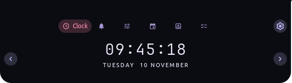
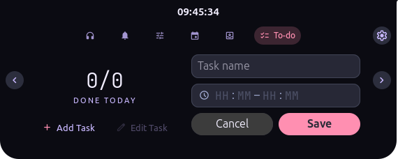
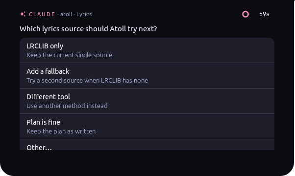

# Atoll

**A Dynamic Island for your Ubuntu desktop.** Atoll turns the middle of the
GNOME top bar into a small black notch. It shows the time and what's
playing, and opens into handy cards when you hover over it: music with live
lyrics, quick settings, notifications, your calendar, a to-do list, and
more.

<p align="center">
  
</p>

Atoll runs as a normal app. If it ever stops, only the notch disappears; the
rest of your desktop keeps working.

## Features

- **Music**: what's playing, with cover art, play/pause, skip and a
  timeline you can drag. Works with Spotify, YouTube Music in the browser,
  and any player that shows up in GNOME's media controls.
- **Live lyrics**: synced lyrics that follow the song, in the card and in
  the closed notch, one line at a time. Optional English translation.
- **Quick settings**: Wi-Fi, Bluetooth, airplane mode, power mode, Do Not
  Disturb, volume, brightness and lock screen, without opening GNOME
  Settings.
- **Notifications**: new notifications slide out of the notch, and the
  notifications card keeps the latest ones. Click one to open it.
- **Calendar**: a month view and your day's meetings from your Google
  account, with a reminder before each meeting.
- **To-do**: today's tasks with times, ticked off right from the notch.
- **Shelf**: drop files on the notch to keep them handy, drag them out
  later.
- **Water**: a daily water goal with gentle reminders.
- **Little extras**: sleepy eyes that wake up when music plays, peeks when
  your headphones connect or the charger is plugged in, and a peek when a
  long terminal command finishes.
- **For Claude Code users**: answer Claude's questions and permission
  prompts from the notch.

<p align="center">
  
</p>

## Install

**You need:** Ubuntu 24.04 with the standard GNOME desktop, signed in to
"Ubuntu on Xorg". Atoll doesn't work on Wayland yet. To check, open
Settings → About and look at **Windowing System**.

1. Go to the [latest release](../../releases/latest) and download the file
   ending in **`.deb`**.
2. Double-click it and choose **Install** in App Center. If App Center
   won't open it, run this in a terminal from your Downloads folder:
   ```bash
   sudo apt install ./atoll_*.deb
   ```
3. Open **Atoll** from your apps. The notch appears in the top bar and the
   Settings window opens.
4. In Settings, turn on **Start at login** so Atoll is there every time.

**Updates:** Atoll checks for new versions once a day and tells you when
one is out. In Settings → General → **Updates**, click **Check now**, read
what's new, then **Update**: Ubuntu asks for your password and Atoll
restarts on the new version. To remove Atoll, run `sudo apt remove atoll`.

## Settings

Open **Atoll** from your apps, or click the ⚙ in any open card.

| Section | What you can change |
|---|---|
| **General** | **Active** turns the notch on or off. **Start at login** starts Atoll with your desktop. **Show on** picks the monitor: the main one (with the top bar), all of them, or one by name. **Atoll Bridge** is explained below. **Updates** checks for, shows and installs new versions. |
| **Features** | Turn each card and extra on or off: Music (with Lyrics), Eyes, Water, To-do, Shelf, Controls, Notifications, Calendar, Command finished, Claude. Some have their own options, like the daily water goal, reminder hours, or how many minutes before a meeting to remind you. |
| **Card order** | The order of the cards when you open the notch. |
| **Theme** | **Appearance**: light or dark notch, or **System** to follow Ubuntu's style. The accent and secondary colors, or pick a preset. |

A few things to know:

- **Notifications:** while this is on, Atoll shows your notifications and
  GNOME's own pop-ups are paused. They come back when you turn it off or
  quit Atoll.
- **Calendar:** connect your Google account in Ubuntu's **Settings → Online
  Accounts**. Atoll reads the calendar from there.
- **Atoll Bridge:** an optional, tiny GNOME extension that comes with Atoll.
  With it on, clicking a notification opens exactly what it's about (for
  example, the right Discord chat) instead of just the app. Log out and back
  in once after installing, then switch it on in Settings.

## Privacy

Atoll keeps your data on your computer. It only goes online for three
things:

- **Lyrics** come from [LRCLIB](https://lrclib.net), a free lyrics
  database. Atoll sends the song's title and artist, nothing else.
- **Translation** sends the lyrics to Google Translate, and only if you
  turn on the translate button.
- **Updates** ask GitHub for the latest version (once a day; can be turned
  off in Settings).

<details>
<summary><b>Claude Code setup</b> (optional)</summary>



Add this to `~/.claude/settings.json`, then restart Claude Code:

```json
{
  "hooks": {
    "PermissionRequest": [
      { "hooks": [{ "type": "command", "command": "atoll hook permission", "timeout": 90 }] }
    ],
    "PreToolUse": [
      { "matcher": "AskUserQuestion",
        "hooks": [{ "type": "command", "command": "atoll hook question", "timeout": 90 }] }
    ],
    "Stop": [
      { "hooks": [{ "type": "command", "command": "atoll hook stop", "timeout": 10 }] }
    ],
    "Notification": [
      { "matcher": "idle_prompt",
        "hooks": [{ "type": "command", "command": "atoll hook notification", "timeout": 10 }] }
    ]
  }
}
```

If Atoll isn't running, Claude Code asks in the terminal as usual.
</details>

<details>
<summary><b>Terminal setup for "Command finished"</b> (optional)</summary>

To get a peek when a long command finishes, run this once, then open a new
terminal:

```bash
atoll shell-init > ~/.config/atoll/shell.bash
echo 'source ~/.config/atoll/shell.bash' >> ~/.bashrc
```
</details>

<details>
<summary><b>Build it yourself</b></summary>

You need Rust and the GTK 4 development files (`sudo apt install
libgtk-4-dev`).

```bash
packaging/build-deb.sh   # creates target/debian/atoll_<version>_amd64.deb
cargo run                # or run it straight from the source
```

Every push and pull request is checked (format, lint, unit and
integration tests). Every push to `main` that passes is released
automatically: the version goes up by one patch (`0.1.4` → `0.1.5`), or
put `[minor]` or `[major]` in a commit message for a bigger step. The
release notes are the commit titles since the last release, and they're
what Atoll shows as "What's new".
</details>
